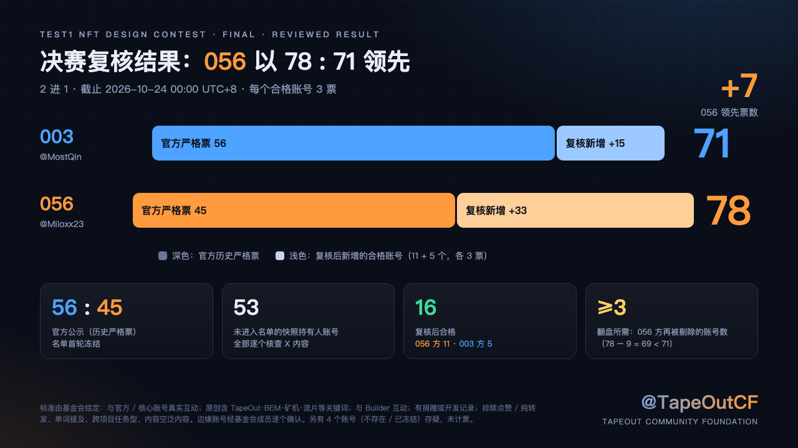
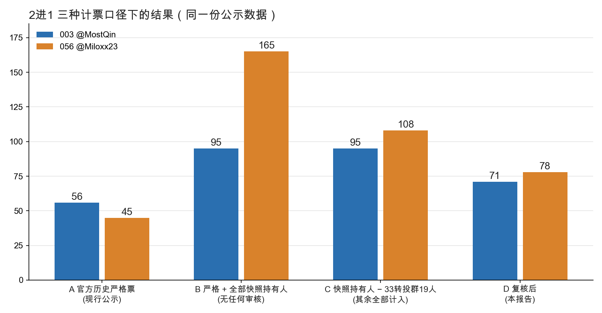
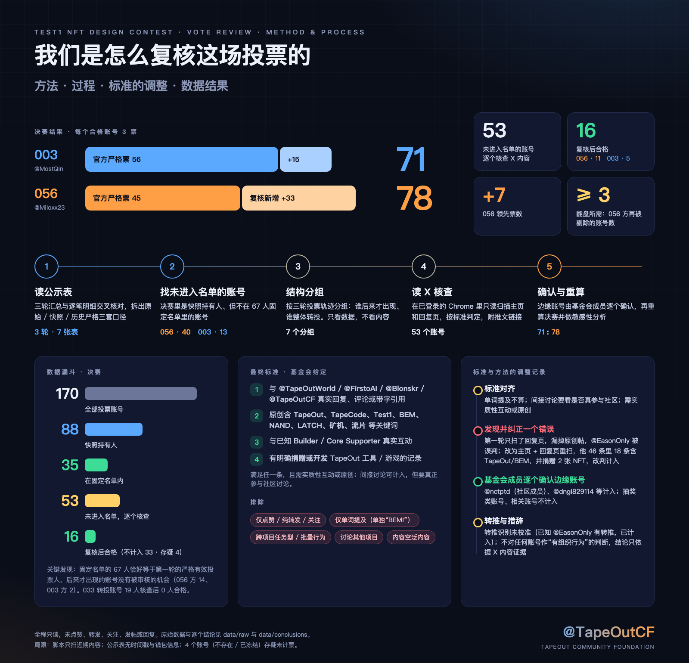
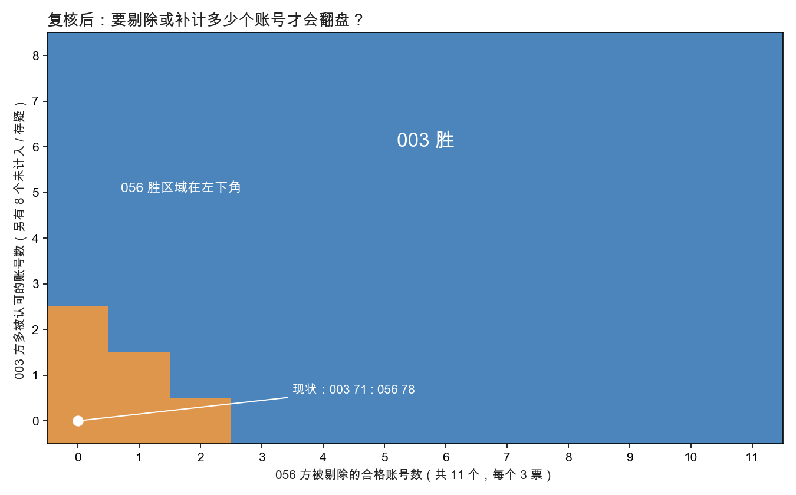

# TapeCode Test1 NFT 设计大赛 · 投票复核报告

> 对决赛（2 进 1：003 @MostQin vs 056 @Miloxx23）的独立复核。
> 数据：官方公示表（2026-10-24 14:38 UTC+8 导出，决赛截止 2026-10-24 00:00 UTC+8）。
> 标准：基金会给定，边缘账号经基金会成员逐个确认。
> 原始数据与逐个结论见 [`data/`](data/)。

## 1. 结论

| | 003 | 056 |
|---|---|---|
| 官方历史严格票 | 56 | 45 |
| 复核后新增（合格账号 × 3 票） | +15（5 个账号） | +33（11 个账号） |
| **复核后** | **71** | **78** |

**056 领先 7 票。** 要翻盘，056 方需再被剔除至少 3 个账号（78 − 9 = 69 < 71），或 003 方多被认可 3 个。

## 2. 数据

### 2.1 三套口径
| 口径 | 含义 |
|---|---|
| 原始票 | 数据库内全部有效提交，含快照持有人和普通 1 票地址 |
| 快照票 | 活动前资产快照内的地址（BEM ≥ 1、持 Test1 NFT、官方矿机、NAND/LATCH），每个合格地址 3 票 |
| 历史严格票 | 快照票 ∩ 首轮前冻结的 67 人固定名单 |

| 赛段 | 原始票/人 | 快照票/人 | 历史严格票/人 |
|---|---|---|---|
| 56 进 3 | 463 / 228 | 354 / 119 | 198 / 67 |
| 3 进 2 | 323 / 168 | 239 / 84 | 101 / 36 |
| 2 进 1 | 342 / 170 | 260 / 88 | 101 / 35 |

### 2.2 决赛逐行核对（与汇总一致）
| | 原始 | 快照 | 严格 | 快照持有人但不在名单 |
|---|---|---|---|---|
| 003 | 99（37 人） | 95（33 人） | 56（20 人） | 13 人 / 39 票 |
| 056 | 243（133 人） | 165（55 人） | 45（15 人） | 40 人 / 120 票 |

056 另有 78 个 1 票地址（非快照持有人），任何口径下都不计，没有争议。

### 2.3 名单的结构性问题
1. **名单只来自第一轮投票人。** 56 进 3 的严格有效投票人正好是 67 人，等于固定名单。第一轮 119 个快照持有人，67 人进名单，52 人未进入名单。
2. **后来的人没有被审核的机会。** 056 方 14 个、003 方 2 个快照账号第一次出现在第 2、3 轮，按规则只能是“不在名单”，与其 X 内容无关。
3. **通过率不对称**：决赛快照持有人通过率 003 为 61%（20/33），056 为 27%（15/55）。
4. 审核依据是“最近 30 条动态”的时点快照，比赛期间才开始参与社区的人天然吃亏。

### 2.4 三种口径的边界
| 口径 | 003 | 056 |
|---|---|---|
| A 官方严格票 | 56 | 45 |
| B 严格 + 全部快照持有人（无审核） | 95 | 165 |
| C 快照持有人 − 033 转投账号 19 人 | 95 | 108 |
| **D 复核后（本报告）** | **71** | **78** |

## 3. 未进入名单的账号的结构分组（只用投票轨迹）

### 056 方（40 人）
| 组 | 人数 | 描述 |
|---|---|---|
| A 033 转投账号 | 19 | 56 进 3 投 033（@jeffwang996），033 被淘汰后，3 进 2、2 进 1 全部转投 056 |
| B 后来才出现 | 14 | 第 2 轮首次出现 7 人，第 3 轮首次出现 7 人 |
| C 一直投 056 | 4 | @karmalou、@Krishna75692159、@Sandhya04215336、@tapeoutnft |
| D 其他 | 3 | 第 1 轮投别的作品，后转 056：@Go_sprs、@nctptd、@verntetry73759 |

### 003 方（13 人）
| 组 | 人数 | 描述 |
|---|---|---|
| E 一直投 003 | 7 | 第 1 轮起每轮都投 003 |
| F 中途转投 003 | 4 | @chexin88888、@dngl829114、@TeZhan0311、@unrealhb |
| G 后来才出现 | 2 | @QIANNIANZONGZI0（第 2 轮）、@steawen5211（第 3 轮） |

033 在第 1 轮有 31 个投票人，其中 23 个是不在名单的快照持有人，19 个后来整体转投 056。
**仅凭投票模式，这既可能是有组织，也可能是支持者的第二选择，数据分不出来**，所以本报告不对任何账号作“有组织行为”的判断，判断只依据 X 内容。

## 4. 标准与方法

### 4.1 标准（基金会给定）
**合格**（满足任一，且需实质性互动或原创）：
1. 与 @TapeOutWorld、@FirstoAI、@Blonskr、@TapeOutCF 任一账号真实回复、评论或带字引用；
2. 原创发布含 TapeOut、TapeCode、Test1、BEM、NAND、LATCH、矿机、流片 等关键词（非纯转发）；
3. 与已知 Builder / Core Supporter 真实互动；
4. 有明确捐赠或开发 TapeOut 相关工具 / 游戏的记录。

**不计入**：仅点赞 / 纯转发 / 关注；仅单词提及（如单独“BEM!”）；跨项目任务型、批量行为；讨论其他项目与 TapeOut 无关；内容空泛内容。间接讨论可计入，但要判断是不是真正参与社区讨论。

### 4.2 做法
1. 读公示表，核对三轮汇总与逐笔明细一致；
2. 找出决赛里“快照持有人但不在名单”的账号（056 方 40、003 方 13）；
3. 按三轮投票轨迹结构分组；
4. 在基金会成员已登录的 Chrome 里**只读**扫描每个账号的主页和 /with_replies 页，提取自发帖、回复对象、转帖，按标准判定，附推文链接（[`scripts/x_timeline_scan.js`](scripts/x_timeline_scan.js)）；
5. 边缘账号由基金会成员逐个确认；
6. 每个合格账号 3 票，重算决赛并做敏感性分析。

### 4.3 标准与方法的调整记录
| 阶段 | 调整 |
|---|---|
| 标准对齐 | 先对齐 3 个口径：单词提及不算；间接讨论要看是否真参与社区；需要实质性互动或原创 |
| 纠正一个错误 | 第一轮只扫了回复页，漏掉原创帖。@EasonOnly 被误判；重扫主页后发现他 46 条自发帖里 18 条含 TapeOut/BEM，并写明“我捐赠两张 NFT”，改判为明确计入。此后对未通过的账号都用“主页 + 回复页”重扫 |
| 转推 | 基金会成员指出 @EasonOnly 有转推 TapeOut 内容（他已计入，不影响结果）。脚本对所有账号的转推数都是 0，说明转推识别未经校准，已在局限中说明 |
| 成员确认边缘账号 | @nctptd（社区成员）、@dngl829114、@fngqiojng11044、@KyymYu、@unrealhb、@madola0429 计入；@tapeagentai、@tapewallet、@LewickiDamian、@0xsenlin 是抽奖类账号，@tapecodenft、@tapeoutnft 不计入，@simplede22、@steawen5211 不计入 |

## 5. 核查结果（未进入名单 53 个账号）

| | 合格 | 不计入 | 存疑 | 合计 |
|---|---|---|---|---|
| 056 方 | 11 | 27 | 2 | 40 |
| 003 方 | 5 | 6 | 2 | 13 |
| 合计 | 16 | 33 | 4 | 53 |

**056 方合格（11）**：@yzm50、@madola0429、@Simon7394466717、@fngqiojng11044、@fernanseers8824、@OGodbuilder、@KyymYu、@sheng_kang12540、@Go_sprs、@EasonOnly、@nctptd

**003 方合格（5）**：@0xWangXKK、@cenhaozai、@dngl829114、@unrealhb、@QIANNIANZONGZI0

**033 转投账号（A 组 19 人）：0 人合格。** 其中 16 人的公开内容是回复 @cashmerelabs、@perlelabs、@sodex_official、@brevis_zk 等其他项目、重复的“白名单”“判图”和邀请码，属于标准里的“跨项目任务型批量行为”；@LewickiDamian 是抽奖类账号；@damien257348238（账号不存在）和 @DhanyDhan6（已冻结）无内容，存疑。

**存疑（4）**：@damien257348238、@DhanyDhan6、@Rainhyz0815、@chexin88888，账号不存在或已冻结，无内容可核，未计票。

每个账号的分组、命中标准、证据链接和备注见 [`data/conclusions/verification_worksheet.csv`](data/conclusions/verification_worksheet.csv)。

## 6. 敏感性

设 056 方合格账号被剔除 k 个、003 方被多认可 m 个：
- 056 = 78 − 3k，003 = 71 + 3m；056 仍领先当且仅当 78 − 3k > 71 + 3m。
- m = 0 时，k ≤ 2 仍领先，k = 3 反超（69 < 71）。
- 被基金会成员判为不计入的 @simplede22、@steawen5211（均投 003，各 3 票，共 6 票）若改计入，003 为 77，仍落后 1 票。

（横轴：056 方被剔除的合格账号数；纵轴：003 方多被认可的账号数。）

## 7. 局限
- 抓取脚本主要看每个账号主页和回复页的近期内容（约 6–14 屏），更早的内容可能没逐条看。
- **转推识别未经校准**：脚本对所有账号的转推数都是 0，但已知 @EasonOnly 有转推 TapeOut 内容。转推本身不改变本报告的结果（@EasonOnly 已因原创和捐赠计入），但其他账号的转推没有被系统核查。
- 4 个存疑账号（不存在 / 已冻结）无内容可查；账号后来改名或注销的，当时是否合格无法回溯。
- @madola0429 的一条原创讲解帖（状态 ID 尾号 436346）完整链接未补；@fernanseers8824 的捐赠记录、@madola0429 的麻将游戏开发记录未独立核实（标准 4）。
- 公示表没有时间戳和钱包信息，无法分析提交时间或资金关联。
- 全程只读：未点赞、转发、关注、发帖或回复。

## 8. 附件
- 一页结果图：[`deck/result.png`](deck/result.png)
- 一页方法汇总：[`deck/method.png`](deck/method.png)
- 一页总结（署名 @TapeOutCF）：[`deck/summary.png`](deck/summary.png)
- 汇报 deck：[`deck/deck.pdf`](deck/deck.pdf)
- 原始数据与结论：[`data/`](data/)
